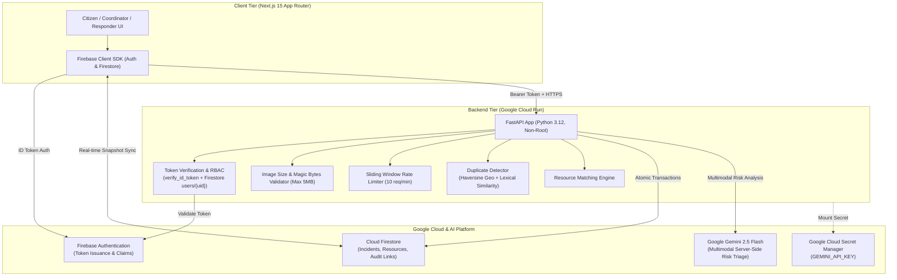

# CommunityOS — AI-Powered Community Emergency Intelligence & Resource Coordination

> **A Greenfield Prototype for the Google Cloud & Gemini H2S Challenge**  
> CommunityOS empowers local communities to report hazards with multimodal verification, evaluate cascading risks via Google Gemini, prioritize incidents, coordinate available resources with transactional safety, and track progress through resolution.

---

## 🏆 150-Word Submission Description

CommunityOS is an AI-powered civic emergency intelligence and resource coordination platform designed to bridge the critical gap between citizen field reports and coordinated municipal responses during urban disruptions. The platform integrates all four mandatory Google Cloud technologies:

- **Google Gemini**: Performs server-side multimodal risk triage using the official GenAI SDK (`google-genai`), generating structured urgency heuristic scores (1–100), severity levels (1–5), visual hazard extraction, cascading risk warnings, and resource recommendations.
- **Firebase Authentication**: Secures all write operations, providing frictionless evaluator access with anonymous sessions and role-based token verification (Citizen, Coordinator, Responder).
- **Cloud Firestore**: Provides real-time reactive sync across command decks, atomic transactional resource dispatching to prevent double-booking, and restrictive security rules.
- **Google Cloud Run**: Hosts the containerized FastAPI backend (Python 3.12, non-root user) with strict CORS allowlisting, rate limiting, and server-side secret management.

---

## 🏗️ System Architecture



---

## 🔑 How the Mandatory Technologies are Used

1. **Google Gemini (`gemini-2.5-flash`)**:
   - Executes server-side in `backend/app/services/gemini_service.py` using the official `google-genai` SDK.
   - Accepts text reports and optional base64 photos (JPEG, PNG, WebP up to 5MB).
   - Produces validated Pydantic JSON: category, severity level (1–5), severity ("Low" to "Critical"), urgency score (1–100), visual evidence cues, cascading risks, recommended actions, and required human sign-off.
   - Implements automated retry and strict timeout controls.
2. **Firebase Authentication**:
   - Authenticates users on the frontend with persistence and token refresh.
   - Backend verifies the Firebase ID token from `Authorization: Bearer <token>` on every protected endpoint (`backend/app/core/auth.py`).
   - Resolves roles (`citizen`, `coordinator`, `responder`) from token custom claims or Firestore `users/{uid}`. Client-supplied role headers or body fields are strictly ignored.
3. **Cloud Firestore**:
   - Stores `incidents`, `resources`, `duplicate_links`, `users`, and `audit_logs`.
   - Resource assignment executes inside an `@firestore.transactional` block, ensuring no unit can be double-booked concurrently.
   - Hardened `firebase/firestore.rules` prevent citizens from modifying assigned units, status, or others' reports.
4. **Google Cloud Run**:
   - Hosts the containerized FastAPI backend (`backend/Dockerfile`) with Python 3.12 and a non-root user.
   - Listens on `$PORT`, enforces CORS allowlists, handles health probes (`/health`), and mounts secrets via Secret Manager.

---

## ⚡ Local Setup & Execution

### 1. Backend Setup
```bash
cd backend
python -m venv venv

# On Windows:
.\venv\Scripts\activate
# On Linux/macOS:
source venv/bin/activate

pip install -r requirements.txt
cp .env.example .env
```
*Add your `GEMINI_API_KEY` into `backend/.env`.*

Run backend server:
```bash
$env:PYTHONPATH="."
python -m uvicorn app.main:app --reload --port 8000
```
Health check endpoint: `http://localhost:8000/health`.

### 2. Frontend Setup
```bash
cd ../frontend
npm install --legacy-peer-deps
cp .env.example .env.local
npm run dev
```
Open [http://localhost:3000](http://localhost:3000).

---

## 🧪 Automated Test Results

Run backend test suite:
```bash
cd backend
$env:PYTHONPATH="."
.\venv\Scripts\pytest -v tests/test_api.py
```
**Actual Result**: `15 passed in 4.30s`
- Health check & CORS allowlisting
- Unauthenticated requests rejected (401)
- Invalid tokens rejected (401)
- Citizen cannot assign resources (403)
- Spoofed role header or body ignored (403)
- Coordinator assigns resources (200)
- Citizen cannot resolve incidents (403)
- Coordinator resolves incidents (200)
- Responder updates progress (200)
- Concurrency conflict on busy resource (409)
- Image size limit > 5MB rejected (400)
- Invalid image MIME type / corrupted magic bytes rejected (400)
- Rate limiting on `/api/incidents/analyze` (429 with `Retry-After`)
- Duplicate detection algorithm (200)
- Resource recommendation engine (200)

Run secret scan:
```bash
cd ..
.\backend\venv\Scripts\python.exe scripts/scan_secrets.py
```
**Actual Result**: `[SUCCESS] CLEAN: Zero secrets or exposed credentials found in repository files.`

Compile frontend production build:
```bash
cd frontend
npm run build
```
**Actual Result**: `✓ Compiled successfully in 74s (9/9 routes verified).`

---

## ⚙️ Environment Variables (Names Only)

### Backend (`backend/.env`)
- `PORT`
- `ENVIRONMENT`
- `GEMINI_API_KEY`
- `GEMINI_MODEL`
- `GEMINI_TIMEOUT_SECONDS`
- `GEMINI_MAX_RETRIES`
- `RATE_LIMIT_PER_MINUTE`
- `FIREBASE_PROJECT_ID`
- `FIREBASE_SERVICE_ACCOUNT_KEY`
- `CORS_ORIGINS`
- `FRONTEND_URL`

### Frontend (`frontend/.env.local`)
- `NEXT_PUBLIC_ENVIRONMENT`
- `NEXT_PUBLIC_FIREBASE_API_KEY`
- `NEXT_PUBLIC_FIREBASE_AUTH_DOMAIN`
- `NEXT_PUBLIC_FIREBASE_PROJECT_ID`
- `NEXT_PUBLIC_FIREBASE_STORAGE_BUCKET`
- `NEXT_PUBLIC_FIREBASE_MESSAGING_SENDER_ID`
- `NEXT_PUBLIC_FIREBASE_APP_ID`
- `NEXT_PUBLIC_BACKEND_URL`

---

## 👤 Evaluator Access & Demo Personas

For frictionless judge evaluation:
1. **Frictionless Demo Access**: Evaluators automatically receive an authenticated session via Firebase Anonymous authentication upon opening the app.
2. **Active Persona Switcher**: In the navigation bar, evaluators can switch between personas:
   - **Coordinator**: Approves resource dispatch, links duplicates, resolves incidents.
   - **Responder**: Views assigned incidents, logs progress notes, marks In Progress.
   - **Citizen**: Reports hazards with photos and tracks status transparently.
3. **Demo Data Banner**: When running in development mode without live Firestore credentials, a visible **"DEMO DATA ACTIVE — DEVELOPMENT MODE"** alert is displayed.

---

## 🌐 Deployment Status & URLs

- **Google Cloud Run URL**: *Pending deployment (see Deployment Guide for gcloud command)*
- **Public Frontend URL**: *Pending deployment (see Deployment Guide for Vercel / Firebase Hosting command)*

---

## 🔒 Security & Disclaimers
* **Disclaimer**: CommunityOS is an experimental technology prototype for evaluators and does not represent an official 911 municipal dispatch service.
* **Secret Protection**: All Gemini API keys are server-side only. Client requests require verified Firebase ID tokens.
